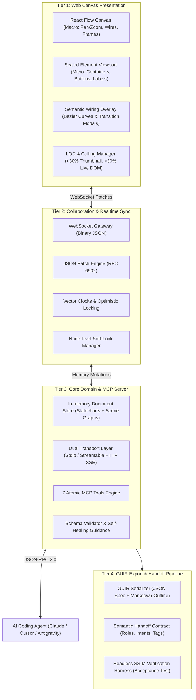

# **TÀI LIỆU KIẾN TRÚC HỆ THỐNG V1 (ARCHITECTURE SPECIFICATION V1)**
# **HỆ THỐNG: LUDUSGRAPH (LUDUSGRAPH MCP)**
### *Agent-Native Game UI Layout & Statechart Intermediate Representation Platform*

---

## **1. TỔNG QUAN HỆ THỐNG & ĐỊNH DANH (SYSTEM IDENTITY & VISION)**

### **1.1. Đặt tên và Định danh Dự án**
* **Tên chính thức:** **LudusGraph** (kết hợp giữa *Ludus* - tiếng Latinh chỉ Trò chơi/Luật chơi, và *Graph* - biểu diễn đồng thời Scene Graph phân cấp và Statechart Flow Graph).
* **Mã định danh gói (Package Identifier):** `@ludusgraph/core`, `@ludusgraph/mcp-server`, `@ludusgraph/web-canvas`.
* **Tên gọi giao thức/đặc tả:** **GUIR** (*Game UI Intermediate Representation* - Bản đặc tả trung gian giao diện trò chơi).
* **Khẩu hiệu kỹ thuật:** *"The Single Source of Truth for AI-Human Collaborative Game UI Ideation & Layout Flow."*

### **1.2. Tầm nhìn Kiến trúc & Định vị Hệ thống**
LudusGraph được định vị là **Tầng trừu tượng hóa bố cục trung gian (Layout Intermediate Representation Layer)** độc lập trên nền tảng Web. Hệ thống giải quyết điểm nghẽn nghiêm trọng nhất trong quy trình AI Game Development hiện nay: **sự thiếu hụt nhận thức không gian thị giác (Visual Spatial Blindness)** của các tác tử dòng lệnh (Cursor, Claude Code, Antigravity) khi thiết kế giao diện game mà không làm bùng nổ token ngữ cảnh hay phá hỏng scene file của Game Engine (Godot, Unity).

```
+-----------------------------------------------------------------------------------+
|                                 LUDUSGRAPH ECOSYSTEM                              |
|                                                                                   |
|   +-----------------------+                         +-------------------------+   |
|   |   Human Game Dev /    |   Visual Editing        |   AI Coding Agent       |   |
|   |   UI Designer         |   (Drag, Wire, Focus)   |   (Cursor, Claude Code) |   |
|   +-----------+-----------+                         +------------+------------+   |
|               |                                                  |                |
|               | (WebSocket / JSON Patch)                         | (MCP stdio/HTTP|
|               v                                                  v  7 Atomic Tools|
|   +---------------------------------------------------------------------------+   |
|   |                  LUDUSGRAPH CENTRAL SYNC & MCP SERVER                     |   |
|   |  - In-memory Document Store (Scene Graph + Flow Graph)                    |   |
|   |  - JSON Patch Engine (RFC 6902) & Vector Clocks OCC                       |   |
|   |  - Node-Level Soft-Locking Manager & Self-healing Error Protocol          |   |
|   +-------------------------------------+-------------------------------------+   |
|                                         |                                         |
|                                         | Xuất GUIR Artifacts                     |
|                                         v                                         |
|                 +-----------------------------------------------+                 |
|                 |  1. layout_spec.guir.json (Cấu trúc máy đọc)  |                 |
|                 |  2. layout_summary.md (Tối ưu token cho LLM)  |                 |
|                 +-----------------------+-----------------------+                 |
+-----------------------------------------|-----------------------------------------+
                                          |
                                          | Handoff Boundary (Ranh giới chuyển giao)
                                          v
                  +-----------------------------------------------+
                  |       DOWNSTREAM ENGINE COMPILER AGENT        |
                  |  (Độc lập; diễn giải GUIR -> Nodes cụ thể)    |
                  +-----------------------+-----------------------+
                                          |
                         +----------------+----------------+
                         | (godot-mcp)                     | (unity-mcp)
                         v                                 v
            +-------------------------+       +-------------------------+
            |      GODOT ENGINE 4     |       |      UNITY 6 ENGINE     |
            | Control Nodes (.tscn)   |       | UI Toolkit / uGUI       |
            +-------------------------+       +-------------------------+
```

### **1.3. Nguyên tắc Thiết kế Bất biến (Architectural Invariants)**
1. **Engine-Agnostic Ideation:** Web Canvas và MCP Server tuyệt đối không chứa logic biên dịch riêng cho Godot (.tscn) hay Unity (.prefab). Trách nhiệm này thuộc hoàn toàn về Downstream Compiler Agent.
2. **Context-Window Frugality:** Mọi schema trao đổi với tác tử phải tối ưu dung lượng token. Tách rời công cụ xem tổng quan (`canvas_get_overview`) và công cụ xem chi tiết (`frame_get_details`).
3. **Deterministic Coordinates via Anchors:** Cấm sử dụng tọa độ điểm ảnh tuyệt đối không có neo. Mọi phần tử phải neo theo `anchor_preset` kết hợp phần trăm tương đối `[0.0, 1.0]` và pixel offset.
4. **Statecharts as First-Class Citizens:** Dây nối giữa các khung hình không phải là đường vẽ vô tri mà là bộ chuyển trạng thái hoàn chỉnh (Trigger, Guard, Action, Animation Hint).

---

## **2. KIẾN TRÚC PHÂN TẦNG HỆ THỐNG (TIERED SYSTEM ARCHITECTURE)**

Hệ thống được thiết kế theo 4 phân tầng độc lập:



---

## **3. MÔ HÌNH DỮ LIỆU ĐẶC TẢ GUIR V1.0.0 (DATA MODEL & SCHEMA SPECIFICATION)**

Mô hình dữ liệu của LudusGraph kết hợp hai cấu trúc:
1. **Scene Graph (Phân cấp không gian cục bộ):** Cây node hiển thị bên trong từng Khung hình (Frame).
2. **Statechart Flow Graph (Máy trạng thái phân nhánh):** Đồ thị chuyển trạng thái giữa các Khung hình thông qua các Dây nối (FlowWires).

### **3.1. Hệ tọa độ chuẩn hóa**
* **Tọa độ Không gian làm việc (World Coordinates):** $(X_{world}, Y_{world}) \in \mathbb{R}^2$ xác định vị trí và kích thước của các Khung hình trên canvas vô tận.
* **Tọa độ Phần tử Cục bộ (Normalized Frame Coordinates):** Tọa độ của UIElement được tính toán tương đối theo kích thước phần tử cha:
  $$\begin{cases} X_{final} = W_{parent} \cdot Anchor_{minX} + Offset_{left} \\ Y_{final} = H_{parent} \cdot Anchor_{minY} + Offset_{top} \end{cases}$$
* **Anchor Presets chuẩn:**
  * Căn góc: `top_left`, `top_right`, `bottom_left`, `bottom_right`
  * Căn giữa: `center`, `center_top`, `center_bottom`
  * Tràn khung: `full_rect`, `h_stretch_top`, `v_stretch_left`

### **3.2. JSON Schema hoàn chỉnh (GUIR v1.0.0 Specification)**
```json
{
  "$schema": "https://json-schema.org/draft/2020-12/schema",
  "title": "LudusGraphUIIntermediateRepresentation",
  "type": "object",
  "required": ["version", "project_meta", "frames", "wires"],
  "properties": {
    "version": { "type": "string", "const": "1.0.0" },
    "project_meta": {
      "type": "object",
      "required": ["project_name", "target_aspect_ratio", "base_resolution"],
      "properties": {
        "project_name": { "type": "string" },
        "target_aspect_ratio": { "type": "string", "enum": ["16:9", "9:16", "4:3", "21:9", "custom"] },
        "base_resolution": {
          "type": "object",
          "required": ["width", "height"],
          "properties": {
            "width": { "type": "integer", "default": 1920 },
            "height": { "type": "integer", "default": 1080 }
          }
        }
      }
    },
    "frames": {
      "type": "array",
      "items": { "$ref": "#/$defs/FrameNode" }
    },
    "wires": {
      "type": "array",
      "items": { "$ref": "#/$defs/FlowWire" }
    }
  },
  "$defs": {
    "FrameNode": {
      "type": "object",
      "required": ["id", "name", "world_transform", "root_element"],
      "properties": {
        "id": { "type": "string", "pattern": "^frm_[a-zA-Z0-9_]+$" },
        "name": { "type": "string" },
        "world_transform": {
          "type": "object",
          "required": ["x", "y", "width", "height"],
          "properties": {
            "x": { "type": "number" },
            "y": { "type": "number" },
            "width": { "type": "number", "minimum": 100 },
            "height": { "type": "number", "minimum": 100 }
          }
        },
        "root_element": { "$ref": "#/$defs/UIElement" }
      }
    },
    "UIElement": {
      "type": "object",
      "required": ["id", "name", "type", "layout", "semantics"],
      "properties": {
        "id": { "type": "string", "pattern": "^(node|btn|lbl|cnt|img|rect|elp)_[a-zA-Z0-9_]+$" },
        "name": { "type": "string" },
        "type": {
          "type": "string",
          "enum": ["container", "button", "label", "rect", "ellipse", "image_placeholder"]
        },
        "layout": {
          "type": "object",
          "required": ["anchor_preset", "offsets"],
          "properties": {
            "anchor_preset": {
              "type": "string",
              "enum": [
                "top_left", "top_right", "bottom_left", "bottom_right",
                "center", "center_top", "center_bottom",
                "full_rect", "h_stretch_top", "v_stretch_left"
              ]
            },
            "offsets": {
              "type": "object",
              "properties": {
                "left": { "type": "number", "default": 0 },
                "top": { "type": "number", "default": 0 },
                "right": { "type": "number", "default": 0 },
                "bottom": { "type": "number", "default": 0 }
              }
            },
            "flex_direction": { "type": "string", "enum": ["none", "horizontal", "vertical"], "default": "none" },
            "gap": { "type": "number", "default": 0 },
            "padding": { "type": "number", "default": 0 }
          }
        },
        "visual": {
          "type": "object",
          "properties": {
            "bg_color": { "type": "string", "pattern": "^#([A-Fa-f0-9]{6}|[A-Fa-f0-9]{8})$" },
            "border_color": { "type": "string", "pattern": "^#([A-Fa-f0-9]{6}|[A-Fa-f0-9]{8})$" },
            "border_width": { "type": "number", "minimum": 0, "default": 0 },
            "corner_radius": { "type": "number", "minimum": 0, "default": 0 },
            "text_content": { "type": "string" },
            "font_size": { "type": "number", "minimum": 6, "default": 14 },
            "text_align": { "type": "string", "enum": ["left", "center", "right"], "default": "center" },
            "opacity": { "type": "number", "minimum": 0, "maximum": 1, "default": 1.0 }
          }
        },
        "semantics": {
          "type": "object",
          "required": ["role", "intent"],
          "properties": {
            "role": { "type": "string", "example": "cta_button" },
            "intent": { "type": "string", "example": "start_gameplay" },
            "tags": { "type": "array", "items": { "type": "string" } },
            "custom_payload": { "type": "object" }
          }
        },
        "children": {
          "type": "array",
          "items": { "$ref": "#/$defs/UIElement" },
          "default": []
        }
      }
    },
    "FlowWire": {
      "type": "object",
      "required": ["id", "source_frame_id", "source_node_id", "target_frame_id", "transition"],
      "properties": {
        "id": { "type": "string", "pattern": "^wire_[a-zA-Z0-9_]+$" },
        "source_frame_id": { "type": "string" },
        "source_node_id": { "type": "string" },
        "target_frame_id": { "type": "string" },
        "transition": {
          "type": "object",
          "required": ["trigger", "action"],
          "properties": {
            "trigger": {
              "type": "string",
              "enum": ["on_click", "on_hover", "on_timeout", "on_condition_met"]
            },
            "guard": { "type": "string" },
            "action": {
              "type": "string",
              "enum": ["navigate_replace", "push_popup", "pop_screen", "toggle_overlay"]
            },
            "animation_hint": {
              "type": "string",
              "enum": ["instant", "fade", "slide_left", "slide_up"],
              "default": "fade"
            }
          }
        }
      }
    }
  }
}
```

---

## **4. ĐẶC TẢ GIAO THỨC MODEL CONTEXT PROTOCOL (MCP)**

Hệ thống cung cấp một bề mặt giao tiếp tối giản gồm đúng **7 công cụ nguyên tử (Atomic Tools)**, đảm bảo tác tử AI có thể thực hiện mọi thao tác cấu trúc không gian mà không gây quá tải cửa sổ ngữ cảnh.

### **4.1. Danh mục 7 Công cụ MCP Cốt lõi**

| # | Tên công cụ | Mô tả chức năng | Mục đích Token Optimization |
|---|---|---|---|
| **1** | `canvas_get_overview` | Lấy danh sách metadata của tất cả Frames và FlowWires trên canvas (chỉ trả về ID, tên, kích thước, liên kết). | Tránh nạp toàn bộ cây node, tiêu thụ < 300 tokens. |
| **2** | `frame_get_details` | Lấy chi tiết cây Scene Graph đầy đủ của duy nhất một `frame_id`. | Chỉ nạp chi tiết khung mà tác tử sắp chỉnh sửa. |
| **3** | `frame_create` | Tạo một khung canvas mới tại tọa độ thế giới chỉ định. | Khởi tạo màn hình mới với tỷ lệ chuẩn (16:9, 9:16). |
| **4** | `frame_batch_mutate` | Thực hiện giao dịch nguyên tử hàng loạt: `add`, `update`, `delete`, `move` các UIElement bên trong Frame. | Đảm bảo tính lũy đẳng (Idempotence) và tiết kiệm số lượt gọi công cụ. |
| **5** | `flow_wire_connect` | Tạo dây nối luồng Statecharts giữa một tương tác node và khung đích. | Khởi tạo logic chuyển trạng thái giao diện. |
| **6** | `flow_wire_disconnect`| Xóa dây nối luồng bằng `wire_id`. | Điều chỉnh cấu trúc máy trạng thái. |
| **7** | `canvas_export_guir` | Xuất toàn bộ canvas ra file `layout_spec.guir.json` và bản tóm tắt `layout_summary.md`. | Chuẩn bị bàn giao cho Downstream Agent. |

### **4.2. Chi tiết Input/Output Schema của từng Công cụ**

#### **Tool 1: `canvas_get_overview`**
* **Input Schema:** `{ "type": "object", "properties": {} }`
* **Output Example:**
```json
{
  "total_frames": 2,
  "frames": [
    { "id": "frm_title", "name": "Title Screen", "world_x": 0, "world_y": 0, "width": 1920, "height": 1080 },
    { "id": "frm_char_select", "name": "Character Select", "world_x": 2200, "world_y": 0, "width": 1920, "height": 1080 }
  ],
  "wires": [
    {
      "id": "wire_01",
      "from": { "frame_id": "frm_title", "node_id": "btn_start" },
      "to": { "frame_id": "frm_char_select" },
      "trigger": "on_click",
      "action": "navigate_replace"
    }
  ]
}
```

#### **Tool 2: `frame_get_details`**
* **Input Schema:**
```json
{
  "type": "object",
  "required": ["frame_id"],
  "properties": {
    "frame_id": { "type": "string", "description": "ID của khung hình cần lấy chi tiết" }
  }
}
```
* **Output:** Trả về đối tượng `FrameNode` hoàn chỉnh (bao gồm `root_element` và toàn bộ cây `children`).

#### **Tool 3: `frame_create`**
* **Input Schema:**
```json
{
  "type": "object",
  "required": ["name", "world_x", "world_y"],
  "properties": {
    "name": { "type": "string" },
    "world_x": { "type": "number" },
    "world_y": { "type": "number" },
    "aspect_ratio": { "type": "string", "enum": ["16:9", "9:16", "4:3", "custom"], "default": "16:9" },
    "width": { "type": "number", "default": 1920 },
    "height": { "type": "number", "default": 1080 }
  }
}
```

#### **Tool 4: `frame_batch_mutate` (Công cụ then chốt)**
* **Input Schema:**
```json
{
  "type": "object",
  "required": ["frame_id", "operations"],
  "properties": {
    "frame_id": { "type": "string" },
    "operations": {
      "type": "array",
      "items": {
        "type": "object",
        "required": ["op"],
        "properties": {
          "op": { "type": "string", "enum": ["add", "update", "delete", "move"] },
          "parent_id": { "type": "string", "description": "Bắt buộc với op=add hoặc move" },
          "element_id": { "type": "string", "description": "Bắt buộc với op=update, delete, move" },
          "element": { "$ref": "#/$defs/UIElement", "description": "Dữ liệu phần tử khi op=add" },
          "properties": { "type": "object", "description": "Thuộc tính cần cập nhật khi op=update" },
          "insert_index": { "type": "integer", "description": "Vị trí chèn trong mảng children" }
        }
      }
    }
  }
}
```
* **Output Example:**
```json
{
  "success": true,
  "applied_ops": 3,
  "frame_version": 12,
  "updated_at": "2026-10-13T17:54:00Z"
}
```

#### **Tool 5: `flow_wire_connect`**
* **Input Schema:**
```json
{
  "type": "object",
  "required": ["source_frame_id", "source_node_id", "target_frame_id", "transition"],
  "properties": {
    "wire_id": { "type": "string", "description": "Tùy chọn. Nếu bỏ trống hệ thống tự sinh" },
    "source_frame_id": { "type": "string" },
    "source_node_id": { "type": "string" },
    "target_frame_id": { "type": "string" },
    "transition": {
      "type": "object",
      "required": ["trigger", "action"],
      "properties": {
        "trigger": { "type": "string", "enum": ["on_click", "on_hover", "on_timeout", "on_condition_met"] },
        "guard": { "type": "string" },
        "action": { "type": "string", "enum": ["navigate_replace", "push_popup", "pop_screen", "toggle_overlay"] },
        "animation_hint": { "type": "string", "enum": ["instant", "fade", "slide_left", "slide_up"], "default": "fade" }
      }
    }
  }
}
```

#### **Tool 6: `flow_wire_disconnect`**
* **Input Schema:**
```json
{
  "type": "object",
  "required": ["wire_id"],
  "properties": {
    "wire_id": { "type": "string" }
  }
}
```

#### **Tool 7: `canvas_export_guir`**
* **Input Schema:**
```json
{
  "type": "object",
  "properties": {
    "include_markdown_summary": { "type": "boolean", "default": true }
  }
}
```
* **Output Example:**
```json
{
  "json_spec": { /* Toàn bộ tài liệu JSON GUIR v1.0.0 */ },
  "markdown_summary": "# Game Layout Spec Summary\n- Total Frames: 2\n...",
  "checksum": "sha256-a1b2c3d4..."
}
```

### **4.3. Giao thức Phản hồi Tự Sửa Sai (Self-Healing Error Protocol)**
Khi tác tử truyền tham số sai hoặc vi phạm ràng buộc hình học/phân cấp, MCP Server không bao giờ trả về lỗi chung chung (như `500 Internal Error`). Máy chủ luôn trả về cấu trúc hướng dẫn sửa lỗi:

```json
{
  "isError": true,
  "error_code": "INVALID_LAYOUT_PROPERTY",
  "message": "Giá trị anchor_preset 'middle_center' không hợp lệ tại node 'btn_play'.",
  "invalid_value": "middle_center",
  "valid_options": [
    "top_left", "top_right", "bottom_left", "bottom_right",
    "center", "center_top", "center_bottom", "full_rect", "h_stretch_top", "v_stretch_left"
  ],
  "resolution_guidance": "Vui lòng chọn 'center' nếu bạn muốn căn phần tử chính giữa khung cha."
}
```

---

## **5. ĐỒNG BỘ THỜI GIAN THỰC & CỘNG TÁC NGƯỜI - MÁY (REALTIME COLLABORATION)**

### **5.1. Mô hình Thẩm quyền Trung tâm (Central Authority Store)**
Thay vì sử dụng CRDT phân tán (gây nguy cơ sinh chu trình AST bất hợp lệ khi Agent thực hiện biến đổi cấu trúc hàng loạt), LudusGraph triển khai mô hình **Máy chủ Thẩm quyền Trung tâm**:
* Toàn bộ trạng thái Canvas được lưu trữ trong **In-memory Document Store**.
* Mọi thao tác từ phía Web Client gửi lên qua kết nối WebSocket dưới dạng các lệnh vi mô **JSON Patch (RFC 6902)**.
* Mọi thao tác từ phía AI Agent gửi qua MCP Server (`frame_batch_mutate`) được chuyển dịch thành một tập hợp các JSON Patch tuần tự được kiểm tra toàn vẹn.

### **5.2. Thuật toán Kiểm soát Xung đột Lạc quan (OCC) & Ưu tiên Con người**
* **Vector Clocks:** Mỗi Khung hình mang một số hiệu phiên bản (`frame_version: integer`).
* **Quy tắc giải quyết tranh chấp:**
  1. Khi người dùng đang tương tác chuột trực tiếp (MouseDown, Dragging) trên một node hoặc khung hình, node đó được cấp một **Soft-Lock** cục bộ trong 1000ms.
  2. Nếu AI Agent gửi một patch tác động vào node đang bị soft-lock, máy chủ sẽ tạm hoãn giao dịch trong tối đa 300ms. Nếu sau 300ms người dùng vẫn đang kéo chuột, thao tác của Agent bị từ chối với mã lỗi `NODE_LOCKED_BY_USER`, yêu cầu Agent thử lại sau.
  3. Khi không có khóa cứng, nếu xảy ra xung đột cùng thuộc tính tại cùng một thời điểm, **thao tác của Người dùng luôn có quyền ghi đè cao hơn Agent** (Human-Precedence Rule). AI Agent sẽ nhận được thông báo cập nhật mới qua kênh SSE stream.

---

## **6. KIẾN TRÚC FRONTEND VÀ RENDER VIEWPORT (WEB CANVAS ARCHITECTURE)**

### **6.1. Hybrid Viewport Architecture (Kiến trúc Viewport Lai)**
Giao diện Web Canvas kết hợp hai thư viện nhằm cân bằng giữa khả năng điều phối sơ đồ vĩ mô và độ chính xác điểm ảnh vi mô:

```
+--------------------------------------------------------------------------------+
| REACT FLOW (XYFLOW) - MACRO CANVAS (Hệ tọa độ World vô tận)                   |
|                                                                                |
|   +------------------------------------+    +------------------------------+   |
|   | Custom Node: Frame A (16:9)        |    | Custom Node: Frame B (16:9)  |   |
|   |                                    |    |                              |   |
|   |  +------------------------------+  |    |  +------------------------+  |   |
|   |  | Micro Viewport (DOM Scaled)  |  |    |  | Micro Viewport (DOM)   |  |   |
|   |  | Container (Flex/Anchors)     |  |    |  | ...                    |  |   |
|   |  |   - Button (btn_start)       |  |    |  +------------------------+  |   |
|   |  |   - HealthBar (rect)         |  |    +------------------------------+   |
|   |  +------------------------------+  |                   ^                   |
|   +-----------------+------------------+                   |                   |
|                     |                                      |                   |
|                     +====== FlowWire (Statechart Bezier) ==+                   |
|                             Trigger: on_click                                  |
|                             Action:  push_popup                                |
+--------------------------------------------------------------------------------+
```

1. **React Flow Layer (Macro Canvas):**
   * Quản lý chuyển động Pan (kéo rê), Zoom (thu phóng) từ 10% đến 400%.
   * Quản lý danh sách các Khung hình dưới dạng các Custom Node độc lập.
   * Vẽ các đường dây liên kết Statechart (FlowWires) bằng thuật toán đường cong Bezier tùy biến với cổng vào/ra (Handles) đính tại các cạnh node tương tác.
2. **DOM Scaled Viewport Layer (Micro Canvas):**
   * Bên trong mỗi Custom Node của React Flow, toàn bộ cây Scene Graph của Khung được render thông qua hệ thống HTML5/CSS Sub-tree với cơ chế CSS Container Queries và tỉ lệ co giãn ma trận transform:
     $$Transform = \text{scale}(W_{frame} / W_{base})$$
   * Giải pháp này giữ nguyên độ sắc nét hoàn hảo của phông chữ và đường viền ở mọi cấp độ zoom mà không gặp vấn đề mờ vỡ điểm ảnh của canvas raster.

### **6.2. Thuật toán Culling & LOD (Level of Detail)**
Khi một dự án mở rộng lên đến 30–50 khung hình lớn, việc render toàn bộ DOM con sẽ gây suy giảm FPS nghiêm trọng. LudusGraph áp dụng cơ chế chuyển đổi 2 mức LOD:
* **Mức Zoom > 30% (Detail Mode):** Render đầy đủ cây phần tử DOM tương tác, cho phép kéo thả, chọn lựa và chỉnh sửa trực tiếp.
* **Mức Zoom $\le$ 30% (Thumbnail Mode):** Ẩn toàn bộ cây DOM con; thay thế bằng một ảnh raster thu nhỏ (pre-rendered SVG thumbnail) được cache cục bộ, giảm 90% số lượng DOM nodes trên trình duyệt.

---

## **7. RANH GIỚI BÀN GIAO HẠ NGUỒN VÀ TIÊU CHUẨN NGHIỆM THU (DOWNSTREAM HANDOFF)**

### **7.1. Hợp đồng Ngữ nghĩa (Semantic Contract)**
Hệ thống tuân thủ nguyên tắc phân định trách nhiệm nghiêm ngặt giữa Canvas và Downstream Agent:

```
[ LudusGraph Web Canvas ]
       |
       | Xuất: layout_spec.guir.json & layout_summary.md
       v
[ Downstream Compiler Agent ] (Sở hữu năng lực Game Engine & MCP chuyên biệt)
       |
       +---> Đọc "role": "hud_health"       ==> Sinh TextureProgressBar (Godot) / Slider (Unity)
       +---> Đọc "role": "inventory_grid"   ==> Sinh GridContainer (Godot) / VisualElement Grid (Unity)
       +---> Đọc FlowWire (on_click)        ==> Sinh GDScript: btn.pressed.connect(_on_btn_pressed)
```

### **7.2. Định dạng Tóm tắt Markdown cho Ngữ cảnh Agent (`layout_summary.md`)**
Để giúp Downstream Agent nắm bắt nhanh sơ đồ mà không cần parse toàn bộ JSON nặng nề, file Markdown tóm tắt được cấu trúc theo dạng cây phân cấp súc tích:

```markdown
# LudusGraph Layout Architecture
Base Resolution: 1920x1080 (16:9)

## Frame: Title Screen (`frm_title`)
- Root: `cnt_root` [full_rect]
  - Container: `cnt_menu` [center, flex_vertical, gap=16]
    - Button: `btn_play` [role: cta_button, intent: start_game] -> "START GAME"
    - Button: `btn_settings` [role: nav_button, intent: open_settings] -> "SETTINGS"
    - Button: `btn_quit` [role: nav_button, intent: quit_app] -> "EXIT"

## Wires & Transitions:
- `btn_play` (on_click) ==[navigate_replace]==> `frm_char_select`
- `btn_settings` (on_click) ==[push_popup]==> `frm_settings_modal`
```

### **7.3. Tiêu chuẩn Nghiệm thu Độc lập bằng SSIM**
* **Chỉ số:** Structural Similarity Index ($SSIM$)
  $$SSIM(x, y) = \frac{(2\mu_x\mu_y + C_1)(2\sigma_{xy} + C_2)}{(\mu_x^2 + \mu_y^2 + C_1)(\sigma_x^2 + \sigma_y^2 + C_2)}$$
* **Quy chuẩn:** $SSIM \ge 0.88$ giữa ảnh render chuẩn từ Web Canvas và ảnh chụp headless runtime từ Godot/Unity engine là tiêu chí đánh giá độc lập để xác nhận một Downstream Agent đã biên dịch thành công.

---

## **8. CẤU TRÚC MÃ NGUỒN VÀ TECH STACK (IMPLEMENTATION BLUEPRINT)**

### **8.1. Cấu trúc Monorepo Dự án**
Dự án được tổ chức dưới dạng monorepo sử dụng `pnpm workspaces`:

```
ludusgraph/
├── packages/
│   ├── core/                        # Logic miền lõi, Types & Schemas
│   │   ├── src/
│   │   │   ├── schemas/             # Zod Schemas & JSON Schema generator
│   │   │   ├── types/               # TypeScript interfaces (GUIR, Elements, Wires)
│   │   │   ├── layout/              # Thuật toán tính toán Anchors & Flexbox
│   │   │   └── patch/               # Logic tạo và kiểm định JSON Patch (RFC 6902)
│   │   └── package.json
│   │
│   ├── mcp-server/                  # Máy chủ MCP độc lập
│   │   ├── src/
│   │   │   ├── index.ts             # Điểm khởi chạy CLI (hỗ trợ cờ --stdio hoặc --http)
│   │   │   ├── tools/               # Định nghĩa 7 công cụ MCP nguyên tử
│   │   │   ├── transports/          # stdio transport & Streamable HTTP / SSE transport
│   │   │   └── errors/              # Bộ sinh phản hồi Self-healing error
│   │   └── package.json
│   │
│   ├── sync-server/                 # Máy chủ Đồng bộ hóa Trung tâm
│   │   ├── src/
│   │   │   ├── store/               # In-memory Document Store
│   │   │   ├── ws/                  # WebSocket Server gateway
│   │   │   ├── lock/                # Soft-lock Manager cho nodes & frames
│   │   │   └── persistence/         # Đọc/ghi tệp dự án (.guir.json) cục bộ
│   │   └── package.json
│   │
│   └── web/                         # Ứng dụng Giao diện Web Canvas
│       ├── src/
│       │   ├── components/
│       │   │   ├── canvas/          # React Flow Canvas, Custom Frame Nodes
│       │   │   ├── micro-canvas/    # DOM-scaled Element Viewport (Buttons, Containers)
│       │   │   ├── wires/           # Custom Bezier FlowWire edges & popups
│       │   │   ├── toolbar/         # Thanh công cụ thêm linh kiện game
│       │   │   └── focus-mode/      # Trình biên tập phóng to toàn màn hình
│       │   ├── store/               # Zustand state store đồng bộ với WebSocket
│       │   └── hooks/               # Custom hooks quản lý Hotkeys, Pan/Zoom, LOD
│       ├── index.html
│       ├── vite.config.ts
│       └── package.json
├── package.json
└── pnpm-workspace.yaml
```

### **8.2. Lựa chọn Công nghệ Chi tiết**
* **Ngôn ngữ:** TypeScript 5.5+ (Strict mode 100%).
* **Thư viện Web Canvas:**
  * `@xyflow/react` (React Flow v12) - Giấy phép MIT vĩnh viễn, quản lý Macro canvas & FlowWires.
  * `lucide-react` - Bộ icon tinh gọn cho các công cụ thiết kế.
  * `zustand` - Quản lý trạng thái client cực nhẹ, hỗ trợ middleware đồng bộ WebSocket.
* **Tầng Giao thức & Đồng bộ:**
  * `@modelcontextprotocol/sdk` - Bộ SDK chuẩn của Anthropic/MCP hỗ trợ Stdio và SSE.
  * `fast-json-patch` - Triển khai chuẩn RFC 6902 hiệu năng cao cho Node.js và Browser.
  * `ws` - WebSocket server chuẩn cho Node.js.
  * `zod` - Runtime schema validation và sinh JSON Schema tự động.

---

## **9. KẾ HOẠCH QUẢN TRỊ RỦI RO & BỘ THỬ NGHIỆM SPIKES (G1 - G4)**

| Mã | Giả định Kỹ thuật Cốt lõi | Chỉ số Đo lường (KPI) | Tiêu chí Pass | Kế hoạch Dự phòng (Fallback Plan) |
|---|---|---|---|---|
| **G1** | Tác tử AI đọc hiểu bản đặc tả bố cục chính xác qua định dạng Hybrid. | Độ chính xác trả lời quan hệ không gian trong bộ 20 câu hỏi; Số token tiêu thụ. | $\ge 95\%$ chính xác; Giảm $\ge 40\%$ token so với Figma JSON. | Nếu AI vẫn nhầm lẫn quan hệ cha-con, nạp thêm chuỗi XPath phân cấp ngắn gọn vào metadata của từng node. |
| **G2** | Tác tử gọi công cụ MCP ổn định, không làm trôi tọa độ và không lặp vô hạn. | Tỷ lệ overflow biên; Số bước gọi công cụ; Tỷ lệ tự sửa sai thành công. | $0\%$ tràn biên; Số bước $\le 1.3\times$ tối ưu; Tự sửa sai $100\%$ lần thử 1. | Khóa chặt các giá trị nhập tự do; chuyển toàn bộ tham số định vị sang dạng Enum Presets. |
| **G3** | Bản GUIR xuất ra đủ thông tin để Downstream Agent dựng lại cảnh trên Godot. | Tỷ lệ cảnh biên dịch thành công; Tương đồng thị giác SSIM. | $100\%$ biên dịch không lỗi; $SSIM \ge 0.88$. | Tăng cường thêm trường `layout_summary.md` chi tiết giải thích rõ ý đồ từng Container cho Engine Agent. |
| **G4** | Người dùng và AI cùng chỉnh sửa đồng thời không làm vỡ cấu trúc dữ liệu. | Độ trễ hội tụ trạng thái; Tỷ lệ mất mát dữ liệu; Khung hình giao diện web. | Hội tụ $< 250\text{ms}$; $0\%$ mất dữ liệu; FPS Web $\ge 55$. | Hạ phạm vi khóa từ cấp độ node xuống cấp độ toàn bộ Frame khi Agent đang thực hiện batch mutate. |

---

## **10. KẾT LUẬN & ĐỊNH HƯỚNG BƯỚC TIẾP THEO**
Kiến trúc LudusGraph v1 đã giải quyết trọn vẹn sự cân bằng giữa:
1. **Tính trực quan và tự do** cho nhà phát triển game thông qua không gian canvas vô tận.
2. **Tính kỷ luật và tiết kiệm ngữ cảnh** cho tác tử AI thông qua 7 công cụ MCP nguyên tử và định dạng GUIR chuẩn hóa.
3. **Tính độc lập động cơ** nhờ ranh giới chuyển giao hạ nguồn rõ ràng.

Tài liệu này là cơ sở kỹ thuật chính thức để triển khai lộ trình MVP 14 tuần và kích hoạt các Spike nghiên cứu chi tiết.
